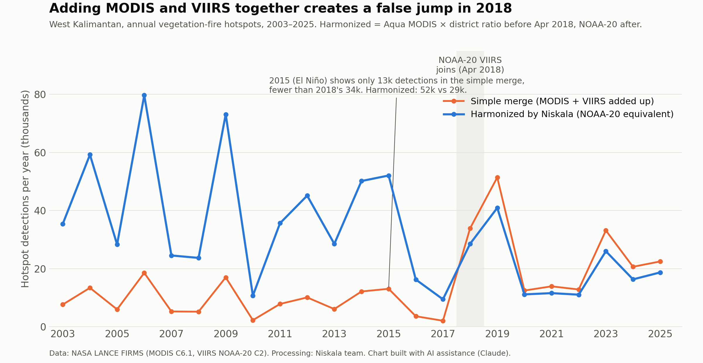

# Niskala – Data Harmonization

This folder turns NASA FIRMS active-fire hotspots from two different sensors (MODIS and VIIRS) into one consistent monthly record for West Kalimantan, Indonesia (2002–2026). The output feeds the Niskala web app, which shows district disaster agencies (BPBD) whether the current fire season is earlier or worse than normal.

## Why harmonize?

MODIS (1 km, since 2000) is retiring. VIIRS (375 m, NOAA-20 since 2018) sees many more small fires. Adding the two together creates a false jump when VIIRS arrives: in the simple merge, the 2015 El Niño year shows fewer detections than 2018. Niskala calibrates MODIS to VIIRS per district so the whole record is comparable.



## Quick start

Large FIRMS files are not stored in this repository. Before the first run, download the yearly country files for **Indonesia** from https://firms.modaps.eosdis.nasa.gov/country/ (MODIS 2001–2025 and VIIRS NOAA-20 2018–2025) into `data/raw/firms/indonesia-yearly/`. Everything else needed is already in `data/raw/`.

```bash
pip install -r requirements.txt
python run_pipeline.py          # all steps (about 3 minutes)
python run_pipeline.py 2 3      # selected steps only
```

Copy `data/web/` to `frontend/public/data/` after running.

To explore the data, open `notebooks/eda.ipynb` after steps 1–3 (summary in [`EDA.md`](EDA.md)). The model comparison is in `notebooks/modeling.ipynb`.

## Folder layout

```
data-harmonization/
├── run_pipeline.py          runs the steps in order
├── requirements.txt
├── EDA.md               EDA findings and preprocessing decisions
├── notebooks/
│   ├── eda.ipynb        exploratory data analysis
│   └── modeling.ipynb   preprocessing, model comparison, forecast
├── pipeline/
│   ├── config.py            all paths and method parameters
│   ├── step1_prepare_hotspots.py
│   ├── step2_harmonize.py
│   ├── step3_anomaly_sipongi_export.py
│   ├── step4_export_points.py
│   ├── step5_chart.py
│   ├── step6_forecast.py    next-month forecast and export
│   ├── forecast_lib.py      preprocessing + models (climatology, persistence, Negative Binomial, LSTM)
│   ├── learning_curves.py   LSTM learning-curve diagnostic
│   ├── lstm_numpy.py        small LSTM in pure numpy (no PyTorch needed)
│   └── eda.py               script version of the EDA
├── data/
│   ├── raw/                 inputs (see "Data sources")
│   ├── interim/             intermediate tables
│   └── web/                 files used by the frontend
└── outputs/figures/
```

## Pipeline

| Step | What it does | Main outputs |
|:---|:---|:---|
| 1 | Merges FIRMS yearly files and the 2026 archive download, keeps the West Kalimantan box, vegetation fires only (`type = 0`; NRT points on known static heat sources removed), MODIS confidence ≥ 30 and VIIRS not `low`, then assigns each point to one of 14 districts | `interim/hotspots_kalbar.csv.gz` |
| 2 | Counts per month in local time (WIB). Calibrates Aqua MODIS to NOAA-20 VIIRS per district over the 2018-04 to 2025-12 overlap, with shrinkage toward the province ratio for small districts. Leave-one-year-out validation | `interim/harmonized_monthly.csv`, `calibration.csv`, `validation.csv` |
| 3 | Monthly baseline (2003–2025, leave-one-year-out) and anomaly classes; comparison with SiPongi burned area; JSON export | `web/meta.json`, `calendar.json`, `sipongi.json`, `annual.json` |
| 4 | Per-district, per-year hotspot CSV files for the download button | `web/points/<district>/<year>.csv` |
| 5 | Slide chart | `outputs/figures/chart_naive_vs_harmonized.png` |
| 6 | One-month-ahead forecast per district: climatology, persistence, **Negative Binomial regression (main)**, and a small LSTM (experimental). Features from the EDA: normal level, last 1–2 months' anomaly, Niño 3.4 (lag 1) in the dry season. Leakage-free tests: train ≤ 2020 → test 2021–2025; train ≤ 2025 → test Jan–Oct 2026 | `web/forecast.json`, `interim/forecast_scores.csv`, `interim/forecast_backtest.csv` |

## Method in brief

* **Reference sensor:** VIIRS NOAA-20 (still operating). **MODIS reference:** Aqua. Terra is excluded because of orbit drift; January 2001 to June 2002 has Terra only and is not harmonized.
* **Calibration:** `r_d = (N20_d + k·R) / (Aqua_d + k)`, k = 100, R = province ratio. Harmonized `H = Aqua × r_d` before April 2018, `H = NOAA-20` after.
* **Anomaly:** `(H + 5) / (normal + 5)` against the same calendar month in 2003–2025, excluding the year being judged. Classes: < 0.33×, 0.33–0.67×, 0.67–1.5×, 1.5–3×, 3–6×, > 6×.

## Key results

| Check | Result |
|:---|:---|
| NOAA-20 / Aqua ratio, West Kalimantan | 5.28 (district range 3.8–8.5) |
| Leave-one-year-out error, district-year (median) | 19.6% with district ratios vs 27.6% with one ratio |
| Intensity-dependent log-log model (tested, not used) | 32.0% |
| Harmonized hotspots vs SiPongi burned area, province 2016–2025 | Spearman 0.90 |
| Normal peak months, West Kalimantan | August–September |
| Ketapang, October 2026 | 8.1× normal |
| Kayong Utara, July 2026 (province only 1.4×) | 8.3× normal |
| Forecast test 2021–2025, MAE per district-month | NB 87 vs climatology 132 vs persistence 132 vs LSTM 148 |
| Forecast test 2021–2025, Brier (above normal) | NB 0.135 vs climatology 0.148 |
| NB 10–90% range, share of actual values inside | 92% (2021–2025), 82% (2026) |
| Extreme 2026 season | All models under-predict the peak; NB gives the highest above-normal probabilities |

## Limitations

* Hotspots are not burned area; one detection can belong to a large fire.
* Cloud, thick smoke, and smouldering peat fires can be missed by satellites.
* August–November 2026 is near-real-time (NRT) data; November 2026 is incomplete.
* The VIIRS/MODIS ratio varies between years (higher in quiet years); calibration overlap is 2018–2025.

## Data sources

* **NASA LANCE FIRMS** – MODIS C6.1 (Terra, Aqua), VIIRS C2 (NOAA-20, Suomi NPP). Yearly country files (Indonesia, 2001–2025) and Archive Download for 2026 (box W 108.0, S −3.1, E 114.2, N 2.1). https://firms.modaps.eosdis.nasa.gov
  *We acknowledge the use of data and imagery from LANCE FIRMS (https://earthdata.nasa.gov/firms), part of the NASA Earth Science Data and Information System (ESDIS).*
* **SiPongi, Ministry of Forestry, Indonesia** – indicative burned area per district, 2016–2026. https://sipongi.gakkum.kehutanan.go.id/indikasi-luas-kebakaran
* **geoBoundaries gbOpen** – IDN ADM2 district boundaries (CC BY 4.0). https://www.geoboundaries.org
* **NOAA PSL** – Niño 3.4 anomaly (ERSST v6), for the planned forecast step. https://psl.noaa.gov/data/timeseries/month/DS/NINO34/

## Use of AI

Code in this folder was written with help from Claude (Anthropic). The project idea, method choices, and verification of results were done by the Niskala team.
